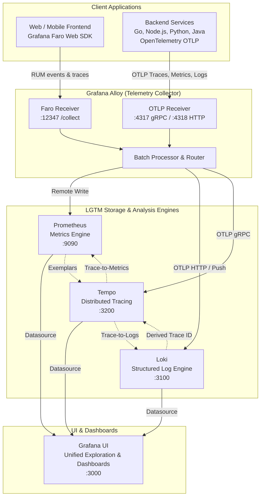

# Observability Stack (Grafana LGTM + Alloy)

[](LICENSE)
[](https://grafana.com)
[](https://opentelemetry.io)
[](https://docker.com)
[](https://coolify.io)

A lightweight, production-ready, self-hosted observability stack based on the **Grafana LGTM** architecture (**L**oki, **G**rafana, **T**empo, Pro**m**etheus) powered by **Grafana Alloy** as a unified telemetry collector.

Designed to be deployed once (on VPS, Coolify, or dedicated server) and shared across all your backend services, microservices, background workers, and web/mobile frontends.

---

## Architecture Overview



### Telemetry Features
- **Traces, Metrics, Logs & RUM in one place**: Single Alloy collector for all telemetry signals.
- **Trace-to-Log & Trace-to-Metrics correlation**: Click a trace span in Tempo and jump directly to relevant Loki logs or Prometheus metrics.
- **Exemplars**: Jump from metric latency spikes in Prometheus directly to the culprit trace in Tempo.
- **Frontend RUM (Real User Monitoring)**: Out-of-the-box support for Grafana Faro Web SDK (captures JavaScript exceptions, Web Vitals, user sessions, and frontend trace propagation).
- **Pre-provisioned Datasources & Dashboards**: Instant visibility with zero manual Grafana configuration.

---

## Ports & Endpoints

| Port | Service | Protocol | Purpose | Access |
|---|---|---|---|---|
| `3000` | Grafana | HTTP | Web UI, Dashboards, Alerting | Public / Protected |
| `4317` | Alloy | gRPC | OpenTelemetry OTLP ingestion | Private / VPN / Tunnel |
| `4318` | Alloy | HTTP | OpenTelemetry OTLP ingestion | Private / VPN / Tunnel |
| `12347` | Alloy | HTTP | Grafana Faro frontend RUM ingestion (`/collect`) | Public (via HTTPS Proxy) |
| `12345` | Alloy | HTTP | Internal collector UI, pipelines & diagnostics | Internal |
| `9090` | Prometheus | HTTP | Metrics TSDB | Internal |
| `3100` | Loki | HTTP | Log aggregation | Internal |
| `3200` | Tempo | HTTP | Distributed tracing | Internal |

---

## Deployment Option 1: Standalone Docker Compose

### Prerequisites
- Docker Engine 24+ & Docker Compose v2+
- `curl` / `git`

### Quick Start
```bash
# 1. Clone repository
git clone https://github.com/Makrorof/observability-stack.git
cd observability-stack

# 2. Copy and configure environment variables
cp .env.example .env
nano .env   # Update GRAFANA_ADMIN_PASSWORD and FARO_CORS_ALLOWED_ORIGINS

# 3. Start the stack
docker compose up -d

# 4. Verify health
docker compose ps
curl -sf http://localhost:12345/-/ready && echo "Alloy is ready"
curl -sf http://localhost:3000/api/health && echo "Grafana is ready"
```

Access Grafana at `http://localhost:3000` (or your server's IP).

---

## Deployment Option 2: Deploying with Coolify

Coolify is an open-source, self-hosted alternative to Heroku/Netlify/Vercel. You can run this shared observability stack as a standalone service in Coolify and use it across all projects.

### Step-by-Step Coolify Setup

1. **Create a New Project or Resource**:
   - Log into your Coolify Dashboard.
   - Navigate to **Projects** → Select/Create a Project (e.g. `Platform` or `Infrastructure`).
   - Click **+ Add Resource** → **Git Repository**.

2. **Select Git Repository**:
   - Choose **Public Repository**.
   - Repository URL: `https://github.com/Makrorof/observability-stack.git`
   - Branch: `main`
   - Build Pack: **Docker Compose**
   - Click **Continue**.

3. **Configure Domains in Coolify**:
   In Coolify service settings, set up public routing for the services you need:
   - **Grafana Web UI**:
     - Assign domain: `https://grafana.yourdomain.com`
     - Port: `3000`
   - **Frontend RUM (Alloy Faro)** *(optional, only if monitoring web apps)*:
     - Assign domain: `https://faro.yourdomain.com`
     - Port: `12347`

4. **Configure Environment Variables**:
   In Coolify's **Environment Variables** tab, define:
   ```env
   GRAFANA_ADMIN_USER=admin
   GRAFANA_ADMIN_PASSWORD=<generate-a-strong-random-password>
   FARO_CORS_ALLOWED_ORIGINS=https://app.yourdomain.com,http://localhost:5173
   PROMETHEUS_RETENTION=15d
   ```

5. **Deploy**:
   - Click **Deploy**.
   - Coolify will pull the repository, launch containers, create persistent Docker volumes, and provision automatic Traefik/Caddy SSL certificates.

---

## Connecting Applications

### 1. Go (OpenTelemetry + Zap / Slog)
Configure standard OpenTelemetry OTLP environment variables:
```bash
export OTEL_EXPORTER_OTLP_ENDPOINT="http://<obs-host>:4317"
export OTEL_EXPORTER_OTLP_INSECURE="true"
export OTEL_SERVICE_NAME="my-go-service"
export OTEL_RESOURCE_ATTRIBUTES="deployment.environment=production"
```

### 2. Node.js / TypeScript
Using `@opentelemetry/sdk-node`:
```typescript
import { NodeSDK } from '@opentelemetry/sdk-node';
import { OTLPTraceExporter } from '@opentelemetry/exporter-trace-otlp-grpc';
import { OTLPMetricExporter } from '@opentelemetry/exporter-metrics-otlp-grpc';

const sdk = new NodeSDK({
  traceExporter: new OTLPTraceExporter({
    url: process.env.OTEL_EXPORTER_OTLP_ENDPOINT || 'http://localhost:4317',
  }),
  metricReader: new PeriodicExportingMetricReader({
    exporter: new OTLPMetricExporter({
      url: process.env.OTEL_EXPORTER_OTLP_ENDPOINT || 'http://localhost:4317',
    }),
  }),
  serviceName: 'my-node-service',
});

sdk.start();
```

### 3. Frontend Web App (React / Vue / Svelte with Grafana Faro)
Install `@grafana/faro-web-sdk`:
```bash
npm install @grafana/faro-web-sdk @grafana/faro-web-tracing
```

Initialize in your frontend root:
```typescript
import { initializeFaro, getWebInstrumentations } from '@grafana/faro-web-sdk';
import { TracingInstrumentation } from '@grafana/faro-web-tracing';

initializeFaro({
  url: 'https://faro.yourdomain.com/collect', // Point to Alloy Faro port 12347 (proxied with HTTPS)
  app: {
    name: 'my-frontend-app',
    version: '1.0.0',
    environment: 'production',
  },
  instrumentations: [
    ...getWebInstrumentations({
      captureConsole: true,
      captureErrors: true,
    }),
    new TracingInstrumentation(),
  ],
});
```

### 4. Same Docker Host / Shared Docker Network
If your applications run on the same Docker host as this observability stack:
1. Attach your app to the `observability-net` network:
   ```yaml
   networks:
     observability-net:
       external: true

   services:
     api:
       networks:
         - default
         - observability-net
       environment:
         - OTEL_EXPORTER_OTLP_ENDPOINT=http://alloy:4317
   ```
2. Or use `host.docker.internal`:
   ```yaml
   services:
     api:
       extra_hosts:
         - "host.docker.internal:host-gateway"
       environment:
         - OTEL_EXPORTER_OTLP_ENDPOINT=http://host.docker.internal:4317
   ```

---

## Security Recommendations

1. **Protect OTLP Ports (`4317` / `4318`)**:
   - Do **NOT** expose ports 4317 or 4318 unauthenticated to the public internet.
   - Use internal Docker networks, WireGuard/Tailscale VPN, or firewall rules (UFW) to only allow connections from known application servers.
2. **Expose Faro (`12347`) via HTTPS Reverse Proxy**:
   - Modern browsers block HTTP telemetry requests sent from HTTPS web pages (Mixed-Content restrictions).
   - Route `https://faro.yourdomain.com/collect` to internal port `12347` using Cloudflare Tunnel, Coolify Traefik, or Caddy.
   - Restrict `FARO_CORS_ALLOWED_ORIGINS` in `.env` to your trusted web application domains.
3. **Change Default Credentials**:
   - Always override `GRAFANA_ADMIN_USER` and `GRAFANA_ADMIN_PASSWORD` in your production `.env` file before launching.

---

## Retention & Storage

Persistent volumes are configured for all stateful services:
- **Prometheus**: 15 days default (adjustable via `PROMETHEUS_RETENTION` in `.env`).
- **Loki**: 14 days default (configured in `loki/loki.yaml` via `retention_period: 336h`).
- **Tempo**: 7 days default (configured in `tempo/tempo.yaml` via `block_retention: 168h`).

---

## License

This project is licensed under the MIT License - see the [LICENSE](LICENSE) file for details.
